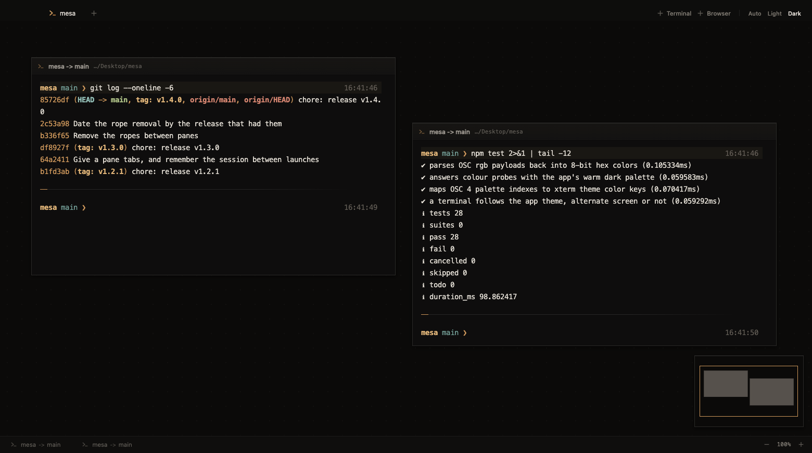

# Mesa

Terminals on an infinite canvas. Put a shell where you want it, leave it there,
and come back to it in the same place tomorrow.



A tabbed terminal makes you remember which tab is which. Mesa gives every
session a *place* instead: drag windows anywhere on an unbounded surface, zoom
out to see the whole workspace, zoom back in to work. Browser panes sit on the
same canvas, so the thing you are building and the page you are checking it on
are side by side rather than behind each other.

## Install

Download the `.dmg` from [Releases](https://github.com/onurkacmaz/mesa/releases)
and drag Mesa to Applications. Apple Silicon only.

The build is **not code-signed**, so macOS will refuse it on first launch. To
open it anyway: right-click the app → **Open** → **Open**. You only do this
once.

## Build from source

Mesa is written in Rust, with [GPUI](https://www.gpui.rs) — Zed's GPU-accelerated
UI framework — for everything on screen. You need a stable Rust toolchain
(`rustup`) and, on a Mac, the Xcode command line tools
(`xcode-select --install`).

```sh
git clone https://github.com/onurkacmaz/mesa.git
cd mesa
cargo run -p mesa --release
```

Other commands:

```sh
cargo test --workspace        # unit tests: the pure core, key mapping, completion sources
cargo build --release -p mesa # the binary alone
scripts/dist-macos.sh         # Mesa.app and an unsigned .dmg into release/ (needs cargo-bundle)
```

`RUST_LOG=mesa=debug` prints what the app is doing to the terminal it was
started from.

## Keys

| | |
|---|---|
| `⌘N` / `⌘B` | new terminal / new browser |
| `⌘1`–`⌘9` | switch tab |
| `⌘T` | new workflow |
| `⌥⌘1`–`⌥⌘9` | switch workflow |
| `⌘W` | close the innermost thing: tab, then window, then workflow |
| `⌘L` | focus a browser pane's address bar |
| `⌘E` / `⇧⌘E` | open the selected terminal's folder in your editor / in a different one |
| `⌘0` / `⇧⌘0` | actual size / fit everything |
| `⌘` + scroll | zoom |
| `space` + drag | pan |

Drag across empty canvas to select several panes; drag a pane by its title bar
to move it, double-click the title to rename it, right-click it for the editor
menu.

## What it remembers

Workflows, panes, tabs, the canvas view, every terminal's folder and every
browser's address are written to `session.json` in the app's data directory
(`~/Library/Application Support/Mesa`) and read back on launch. It is the same
file, in the same place and the same format, that the Electron releases wrote:
a layout saved by Mesa 1.x opens in 2.0 unchanged.

A pty dies with the app, so a restored terminal is a **fresh shell standing in
the folder it was left in** — the layout comes back, the running processes do
not. A tab with a startup command runs it again when it opens.

Answers to questions the app should only ask once — whether the onboarding
cards have been read, which editor `⌘E` opens folders in — and the theme live
in `flags.json` beside it, not in the session. A session that cannot be parsed
is set aside as `session.json.bak` so the next save cannot overwrite it, and a
rescued layout should not also cost an answer already given.

`⌘E` opens the selected terminal's **current** folder, the one its shell last
reported, in whichever editor you picked the first time you pressed it. Mesa
does not embed an editor: it hands the folder to the one already installed.
To change the answer, either press `⇧⌘E` or right-click a terminal's title bar
— both list the editors on this Mac with the current one ticked, and picking
one opens the folder and becomes the new default.

## What it does not do

Worth knowing before you try it:

- **macOS on Apple Silicon is the platform.** It also builds and runs on Linux
  (X11 and Wayland, through GPUI), where the app keys are `⌃⇧` rather than `⌘`
  and a browser pane cannot embed a page — it offers to open the address in
  the system browser instead. Linux is not packaged or regularly tested.
- **The DMG is unsigned and un-notarised.** See the install note above.
- **A page is a native view laid over the canvas.** GPUI draws everything
  else itself, but a web page it cannot draw, so a browser pane's page is the
  system's WKWebView placed over the pane. A native view cannot be clipped or
  covered by anything the canvas paints, so the page is hidden — and a quiet
  placeholder stands in — whenever something should be in front of it: another
  pane overlapping it, a menu, a question, the minimap, or the pane running off
  the edge of the canvas. Move the pane into the clear and the page comes back.
- **"Is something running?" needs zsh.** The check that makes `⌘W` ask before
  killing a live command relies on a zsh prompt hook (OSC 133). Under bash,
  fish or anything else, panes close without asking, and the completion list
  (which reads zsh's own line editor) does not open.
- **No agent orchestration, no git worktree management, no task board.** Mesa
  opens shells and puts them somewhere. That is the whole of it.

## How it is put together

Three crates in one workspace.

```
crates/mesa-core/     pure: what a session file is, how completions are ranked,
                      how a shell's reports and the pty stream are read
crates/mesa/          the app: GPUI window, canvas, panes, terminals, persistence
  src/terminal/       a login shell on a pty, alacritty's grid behind it
  src/ui/app.rs       the window and the workflow strip
  src/ui/workspace.rs the canvas: pan, zoom, selection, pane lifecycle, dock, minimap
  src/ui/terminal_*.rs one terminal tab: the grid painted, keys, completion list
  src/ui/browser_view.rs a browser pane's chrome around a native page
  src/completion.rs   files, branches, PATH, history and the shipped command schemas
  src/storage.rs      the disk: session.json, flags.json, written atomically
crates/mesa-webview/  the native page (WKWebView through wry), free of GPUI
```

The terminal is [alacritty_terminal](https://crates.io/crates/alacritty_terminal)'s
emulator on a [portable-pty](https://crates.io/crates/portable-pty) pty. The
pty's bytes pass through `mesa_core::stream` first, which cuts out the
sequences meant for the app — the folder (OSC 7), the prompt markers (OSC 133)
and the line being edited (OSC 1717) — at the exact point in the stream they
arrive, and drops the one sequence (`CSI 3 J`) that would let `clear` wipe the
scrollback.

`mesa-core` is deliberately free of GPUI, the filesystem and processes, which is
why the part of persistence that can ruin a launch is also the part that is
directly unit-tested. The app crate can see the disk and the ptys; what any of
it means is decided in the core.

## Contributing

See [CONTRIBUTING.md](CONTRIBUTING.md). Issues and pull requests are welcome.

## License

[MIT](LICENSE) © Onur Kaçmaz
